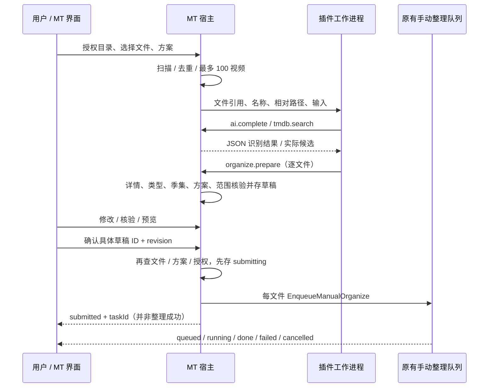

# MT 插件系统设计（SDK v1）

## 范围与边界

插件中心入口为「系统 → 插件中心」，管理 API 位于 `/api/plugins`，沿用 MT JWT 和许可证中间件。插件在同一 MT 可执行文件的独立工作进程中运行 Goja，通过有界逐行 JSON 协议调用宿主。主进程保存凭据并在每次能力调用时检查插件启用状态、安装修订号和资源授权，脚本没有登录凭据。

插件负责提示词、识别策略和声明式界面。宿主负责文件范围、模型配置、TMDB 查询与核验、草稿持久化、用户确认、封存保护和真实媒体操作。宿主只加载 `plugin.json` 和 `dist/index.js`，不执行 npm、构建脚本或插件前端脚本。SDK 不提供数据库、文件内容、环境变量、任意 Go 对象、命令执行、原始 ffprobe、远程 ff 数据、SHA1、直链、Pickcode、Cookie、模型密钥或全局配置。

独立进程用于限制第三方脚本能力与故障传播，并非完整操作系统沙箱。它不能防御宿主机器最高权限持有者，或解释器/操作系统自身的漏洞。

## 安装与版本

GitHub/Gitee 公开 HTTPS 仓库地址与分支/标签经远端 API 解析为 40 位提交号，再下载该提交的 ZIP。清单必须在仓库根目录；拒绝穿越、绝对路径、链接、重复文件、多清单和超限包。入口须为 `dist/index.js`，安装前检查 JS 语法与 SDK 主版本。分发包不在运行时下载额外代码。

清单与入口的规范化内容共同计算 SHA256，先写暂存目录再重命名为内容寻址目录。激活通过数据库安装记录的一次更新完成；校验失败保留旧版。每次加载再次检查摘要。用户重新检查仓库并确认权限后更新；不会后台跟随分支。新增能力默认未授权，必须勾选。保留一个上一版本供回退；回退重新验证配置与授权，成功后停用，待管理员检查后启用。

v1 仅接受 `sdkVersion: "1"`，不运行配置迁移脚本。更新合并仍存在的配置字段和新字段默认值；可在安装预览补充配置。回退不兼容时拒绝，不能静默丢弃或转换值。插件 ID 与源仓库绑定，同名换源需先卸载。

## 权限与 SDK

| 能力 | 资源限制 / 返回值 |
| --- | --- |
| `files.read` | 授权根目录、相对路径；分页、基础信息、不透明文件引用 |
| `ai.chat` / `ai.web.search` | 插件自主管理多轮对话与工具分发；公开搜索独立授权，均不运行宿主识别策略 |
| `ai.complete` | 当前已启用模型；自定义 system/input/schema；仅 JSON 内容、用量 |
| `tmdb.read` | 搜索最多 10 候选、作品摘要、季内集号；无缓存导出 |
| `organize.prepare` | 授权方案；生成核验草稿，不产生媒体副作用 |
| `organize.submit` | 仅 MT 登录用户的确认接口可用；工作进程无此方法 |
| `tasks.read/cancel` | 仅本插件在当前 MT 进程创建的任务 |
| `storage` | 插件 ID 独立命名空间 |
| `notification.send` | 指定授权通知通道，文本消息，不返回通道配置 |
| `strm.run` | 指定授权 STRM 方案，保留核心 STRM 许可证检查 |
| `http.request` | 精确协议、主机、端口、路径子树、方法；默认无授权 |

根目录物理路径仅在管理员管理 API 中出现，不传给脚本。文件 DTO 使用选定授权根内的相对路径、名称、大小、修改时间、是否目录和随机引用。云盘文件对象必须转换为白名单 DTO；不能直接 JSON 序列化 `drive.FileInfo`。本地路径还需物理路径与符号链接范围检查。整理方案只返回名称、目标目录、传输方式、存储类型和启用状态。

HTTP 不继承代理、Cookie 或鉴权请求头。检查每次 DNS 的全部地址，将实际连接固定到已检查 IP，再核对重定向；重定向不得跳出最初授权。始终阻断回环、本机接口、链路本地、云元数据、NAT64/6to4 等特殊范围、MT 服务和已配置远程 ff 节点及其解析地址。私网必须单独授权，且无法绕过这些阻断。

模型调用复用当前 AI 客户端、共享限流、结构化输出兼容协商、超时与配置热更新。AI 关闭/未配置直接报错，不自动启用。热更新更换客户端引用，已开始请求保留其快照，后续请求读取新配置。模型端请求失败对插件返回专用错误，不返回原始 HTTP 响应或密钥。

## 识别与整理生命周期

识别队列与原有媒体队列独立，识别串行运行，避免插件间争抢与媒体任务互相阻塞。文件扫描上限为 100 视频、1000 目录、2000 页、30 层；超限整次明确失败，不静默截断。

草稿状态为 `ready / needs_review / submitting / submitted / submission_unknown`。AI 自报置信度不作为校验。用户修改创建新 revision，旧确认无效；MT 确认弹窗冻结所见草稿及 revision，不从后续轮询悄悄取新值。授权、配置或插件版本更新后，旧识别草稿需重新识别。整理方案目标或传输方式变化也会阻止旧草稿提交，必须重新核验。

确认只接受同一插件、同一运行、同一文件引用的已核验草稿。重新检查文件存在、大小和修改时间（这不能检测所有同大小同时间替换），校验实际 TMDB 类型、季与集。每文件使用 `SourceFile`，不会把混合目录绑定同一作品。封存覆盖只能来自 MT 确认弹窗的明确选项。

写入 `submitting` 发生在入队之前。成功后写 `submitted` 与任务 ID；入队前明确失败保留 `ready` 可重试。重复确认跳过已提交项。崩溃恢复把未完成的提交标记 `submission_unknown`，要求在 MT 任务中心核对，不自动重放。任务所有权绑定宿主会话，防止重启后整数 ID 复用；跨重启任务状态显示中断/待核对。

识别状态与整理状态分别展示。停用立即拒绝新能力调用并取消正在识别的进程；已经入队的整理保留原任务语义并允许在当前会话取消。定时任务只运行识别并持久化草稿；没有确认或自动整理入口。仅重试待处理文件会产生新识别批次，不重放已入队操作。

## 资源与持久化

持久化使用迁移 028 的 `plugin_records`（installation、inspection、run、schedule、按插件隔离 storage）。每条记录上限 8 MiB；全局最多 20 安装、200 运行记录、100 安装预览。预览 30 分钟过期。管理员可清理运行记录；正在识别或当前会话中仍有媒体任务执行时禁止清理。

插件包最多 100 个，每包 ZIP 10 MiB、1000 文件、解压 50 MiB，入口 512 KiB、清单 128 KiB。清理只删除未被当前版、上一版、未过期预览和活动运行引用的包。插件独立 KV 最多 100 键、单值 64 KiB、总 1 MiB。每次运行日志 200 条、每条 500 字节。

每运行最多 2000 RPC，消息 1 MiB、能力请求 256 KiB；AI 输入 128 KiB，返回内容 512 KiB。每次运行 ai.chat 与 ai.complete 合计 78 次（ai.complete 单方法最多 32 次）、公开搜索 32 次、通知 10 次、STRM 10 次、HTTP 50 次，其余单方法最多 500 次。HTTP 请求体 256 KiB、响应 512 KiB、30 秒、最多 5 次重定向。

脚本累计计算时间 30 秒（等待宿主 RPC 不计入）、总体 30 分钟、调用栈 256；工作进程 Go 软内存限制 128 MiB，宿主每 250 ms 检查 RSS，超过 256 MiB 终止。RSS 是采样限制，可能有瞬时超调；软内存限制也不是操作系统硬配额。子进程不继承宿主凭据环境，Windows 仅保留必要的 SystemRoot。发行入口仍执行现有 runtimeguard，不更改加固或授权策略。

## API 摘要

| 方法 | `/api/plugins` 后路径 | 用途 |
| --- | --- | --- |
| GET | 空 / `/:id` | 安装列表 / 详情 |
| POST | `/inspect` / `/template/inspect` | 检查远程仓库 / 内置模板，返回安装票据 |
| POST | `/install` | 票据、grants、config 激活 |
| PUT | `/:id` | enabled/config/grants（整体配置） |
| POST / DELETE | `/:id/rollback` / `/:id` | 回退 / 卸载，`clearData=true` 清 KV |
| POST | `/cleanup` | 清理未引用包 |
| GET | `/:id/files` / `profiles` / `tmdb` | 范围内浏览 / 方案 / 搜索 |
| GET / POST | `/:id/runs` | 历史 / 创建识别运行 |
| GET / DELETE | `/:id/runs/:run` | 运行详情 / 清理历史 |
| POST | `/:id/runs/:run/cancel` / `retry` | 取消识别 / 仅重试待处理 |
| PUT | `/:id/runs/:run/drafts/:draft` | 修正并重新核验 |
| POST | `/:id/runs/:run/confirm` | 登录用户确认：`items: [{id,revision}], overrideSeal` |
| POST | `/:id/tasks/:task/cancel` | 取消所属任务 |
| GET / PUT | `/:id/schedule` | 定时识别设置，五段 Cron |

权威接口类型位于 `frontend/src/api/index.ts` 与 `backend/internal/plugins/types.go`；脚本 SDK 类型与本地模拟仅以根目录 `plugin-sdk/` 为源，模板内 SDK 为固定 1.0.0 的生成快照。

组件页面、Logo、资源安装与 FF 摘要能力的当前契约见 [组件协议 v1](plugins-component-protocol.md)。

## 请求优化与可观测性

SDK v1 增加只读 ai.capabilities()，仅返回当前插件获准的对话、联网和 TMDB 可用状态与固定原因码，不探测或暴露配置。模板仅声明可用工具，资料足够时每批一次结束；每批最多 8 文件，不强制查询顺序，不增加 AI 复核。

宿主对成功的公开搜索和 TMDB 查询使用运行内缓存，键顺序规范化但查询文本不改写；失败不缓存，命中仍校验授权、安装修订、许可证和当前服务状态并计配额，键和值合计最多 4 MiB。缓存不持久化、不跨插件/运行，MT 最终核验独立执行。

Run.stats 是宿主维护的可选统计，记录批次、对话轮次、实际查询、缓存命中、实际模型请求、原生联网、兼容重发及服务报告用量。传输层在失败时也报告请求数，不采信插件自报用量；旧记录显示未记录，缺失用量显示未知。默认值升级仅替换未修改的旧默认，完整自定义配置保留。FF 缓存及凭据不进入上述 DTO、日志或缓存。
