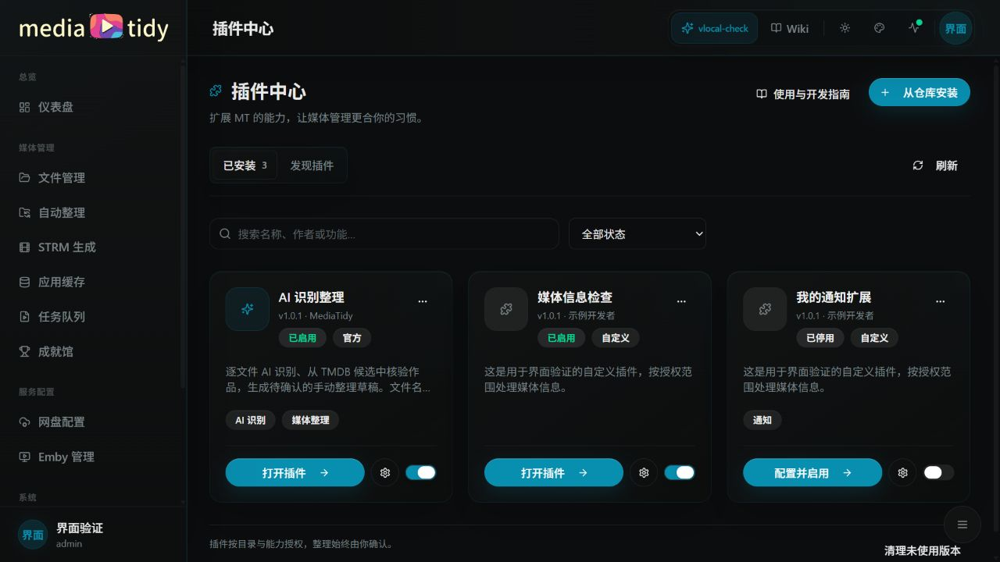
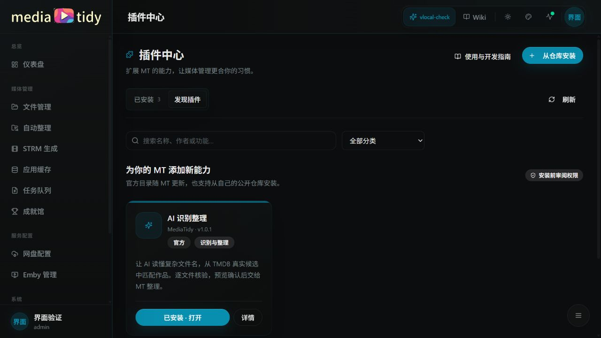
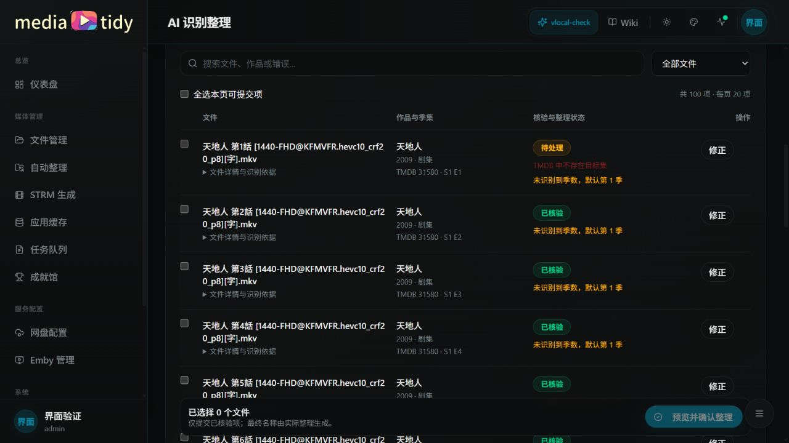
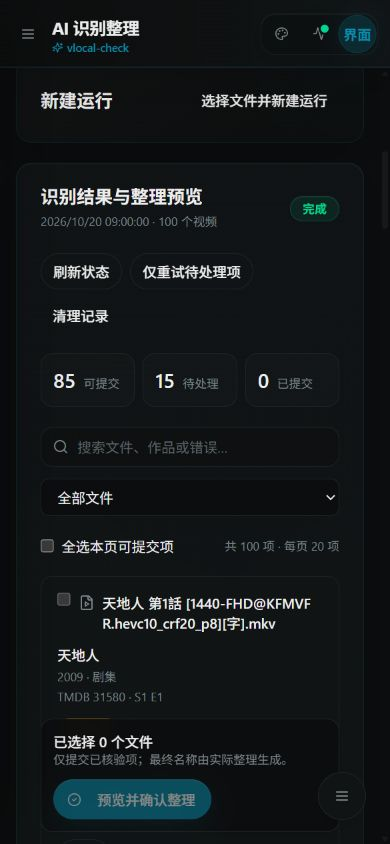

# MT 插件中心 Wiki

这里同时面向插件使用者和开发者。示例插件为 **AI 识别整理 v1.2.1**，使用 **SDK v1**。需要运行已包含新版插件中心的 MT；模板版本不代表 MT 主程序版本。

## 我想使用插件

1. 从 [用户指南](user-guide.md) 完成发现、安装、授权与首次运行。
2. 阅读 [AI 模板说明](ai-template.md)，了解季数默认、核验和人工确认。
3. 遇到问题查看 [发布与排错](release-troubleshooting.md)。

组件 UI v1 已支持插件自定义布局和随包 Logo，无需浏览器插件脚本。完整参考：[组件协议、属性、绑定、事件、资源与预览](component-protocol.md)。

## 我想开发插件

1. [插件中心原理与界面](architecture-ui.md)：宿主与插件的分工，以及 UI 如何生成。
2. [开发入门](quick-start.md)：复制仓库、修改、模拟测试、安装。
3. [清单与 UI 规范](manifest-ui.md)：字段、动作、配置、结果列和完整清单。
4. [SDK 参考](sdk-reference.md)：所有可调用方法、参数、权限与错误。
5. [发布与排错](release-troubleshooting.md)：预打包文件、版本与更新回退。

设计细节：[系统设计](../plugins-design.md) · [开发指南](../plugins-development.md) · [AI 与安全规范](../plugins-ai-security.md)。SDK 的唯一类型来源是 MT 主仓库，当前仓库的 [类型快照](../../sdk/index.d.ts) 和 [模拟 SDK](../../sdk/mock.cjs) 随版本分发。

本文档使用仓库内 Markdown，不依赖 GitHub Wiki 开关，也适用于将模板复制到 Gitee。截图使用模拟媒体和任务，不包含真实凭据。

官方 AI 识别整理插件使用的 Logo：

## 组件页面 v1 示例

[AI 页面分段讲解与桌面／手机深浅主题截图](ai-page-walkthrough.md)。

## 插件中心管理页面

手机端使用结果卡片，保留选择、状态、详情和修正入口：

