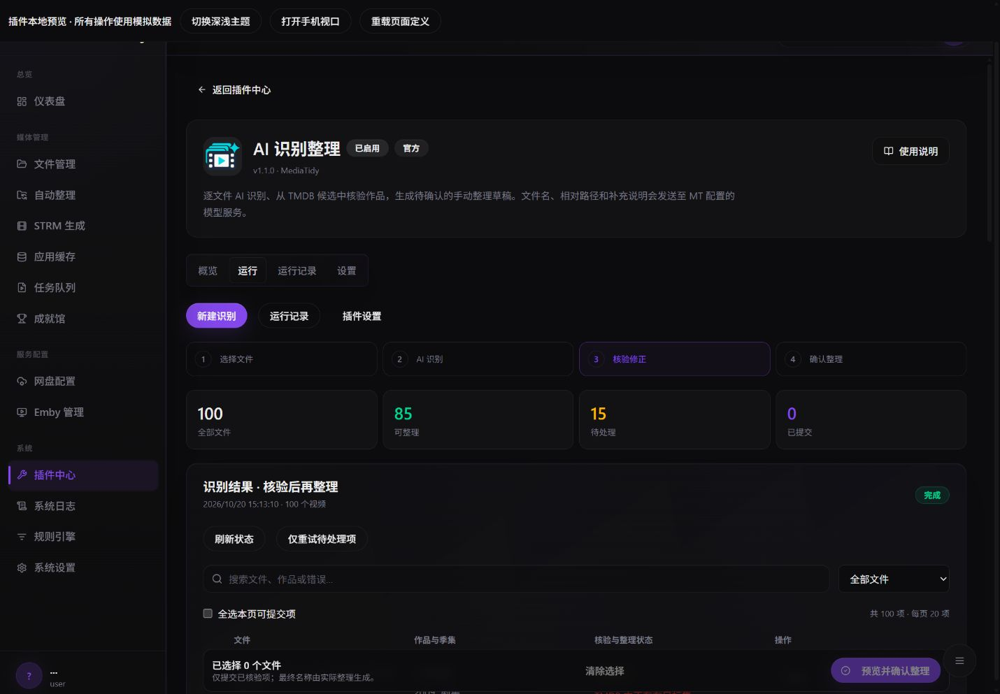
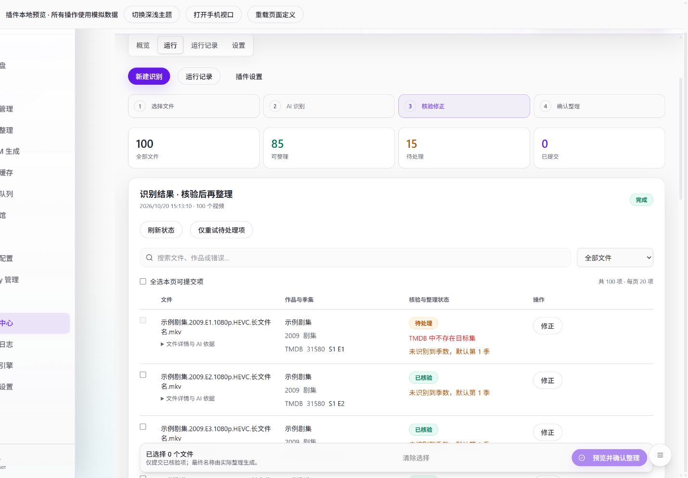

# AI 页面分段讲解

从 [页面源码](../../src/ui/page.ts) 开始。它在开发机器上执行构建器，产出 [静态 JSON](../../ui/page.json)，MT 浏览器只读取产物。不要把 API 密钥放在 UI、源码或配置默认值中。

1. **页签与操作区**：definePage 声明概览、运行、记录、设置。运行页的三个 Button 使用固定事件；start 指向清单中的 recognize 动作。插件不处理路由、不接触登录凭据。
2. **步骤与新建表单**：Steps 绑定 ui.step。Grid 使用 wide-left；左侧 FilePicker，右侧 ProfilePicker 和 Textarea 分别绑定 input.profileId、input.instructions。所有路径和方案范围仍由 MT 校验。ui.canStart 未满足时禁用开始按钮并说明原因。
3. **真实进度**：Progress 使用 stats.drafts / stats.files。文件扫描还没给出数量时显示不定进度；不会编造“已完成 80%”。开始后通过 ui.showNew 收起表单，优先显示结果。
4. **统计筛选**：四个 Metric 使用 stats.files、ready、review、submitted，并声明 filter。MT 维护搜索、筛选、每页 20 项和跨页选择，模板不手工拼接表格 DOM。
5. **作品、季集与依据**：Results 内的 Table 使用 row.file.name、row.media.title、row.media.year、row.seasonEpisode 等白名单绑定。长文件名限制两行；完整名称、相对路径、AI 依据放在 Details 中。作品详情不因季集校验失败而隐藏。错误与默认第一季提示独立呈现。
6. **修正与确认**：row.canEdit/row.canCancel 由 MT 决定展示入口；editDraft 打开原生核验组件。SelectionBar 打开原生确认组件，展示后端草稿中的作品、季集、目标和传输方式；即使模板文案或模型结果恶意，也不能伪造确认结果。已排队与执行成功分别展示。
7. **记录与设置**：RunHistory、ConfigForm、ScheduleForm 使用 MT 管理组件；提示词与定时设置不占每次运行区域。定时只生成草稿。

## 桌面与手机

截图来自 `npm run preview` 的 100 文件模拟数据，使用与 MT 相同的详情页、渲染器和确认组件。可在本地切换主题、设备宽度并修改页面定义验证布局变化，无需更改 MT 页面代码。

所有可用属性、有限谓词、事件约束、Logo 校验、配额和 FF 边界见 [完整协议](component-protocol.md)。新增组件应先进入 MT 通用注册表，而不是在宿主中判断本插件 ID。
