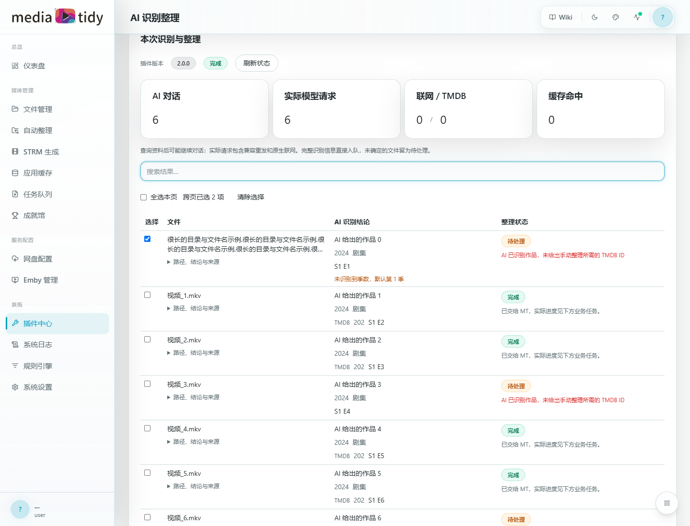
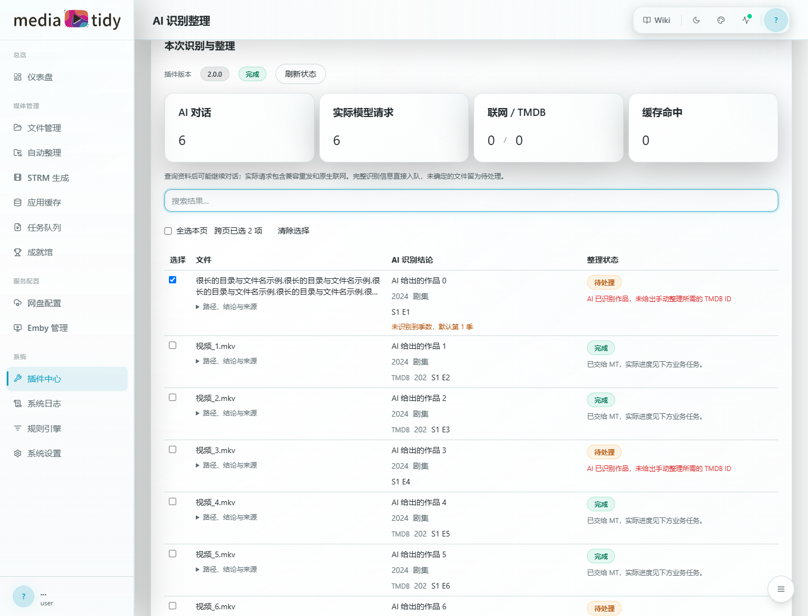
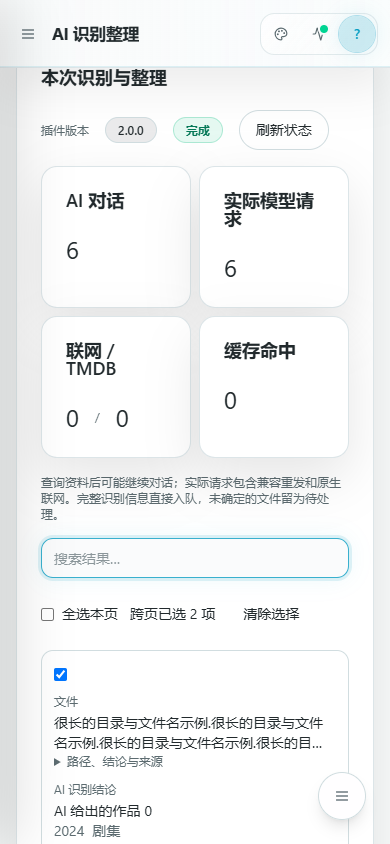
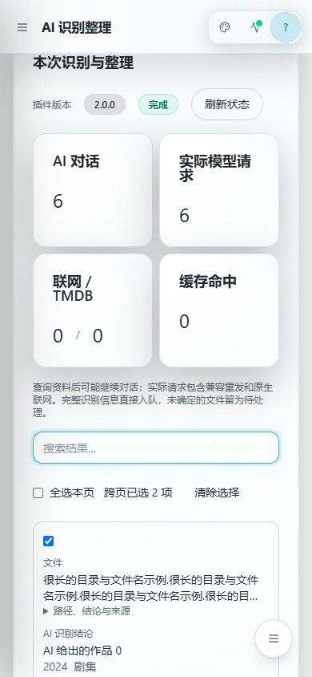

# 页面分解

运行页顶部提供新建整理、运行记录与提示词/授权入口。桌面左侧选择视频、右侧选择方案与补充说明；手机自动纵向排列。开始后收起输入区，突出实际进度与结果。

进度来自 `runtime.progress`，不会模拟固定搜索或复核阶段。结果区显示运行版本、AI 轮次、实际模型请求、联网/TMDB 查询和缓存命中。目录尚在扫描时显示未记录，不将未知用量显示为 0。

每行清楚区分文件、AI 识别结论和整理状态。文件名最多两行，路径、简短结论和公开来源可展开。默认第一季提示与错误分开显示。手机使用可展开卡片。

表格每页 20 项，搜索与跨页选择由通用渲染器提供。重试只处理所选未提交项，不重放业务失败、已提交或结果未知的任务。业务任务区提供实际进度及单独取消。

页面定义是插件源码，调整卡片、表格和文案只需重新构建插件，不修改 MT 页面代码。

## 页面预览

下图是 SDK v2 插件在真实 MT 前端中的页面，接口使用模拟数据，不代表真实模型的识别准确率。没有草稿核验或最终确认按钮。

本地预览读取 `tests/preview.json`，包含 25 行模拟结果、长文件名、缺少 TMDB ID、默认第一季及请求统计。使用同版本 SDK 开发包运行 `npm run preview`，可编辑该文件并刷新检查布局。预览按钮只记录事件，不调用真实 AI 或整理；动作链由 Goja 测试验证。

[返回首页](README.md)
