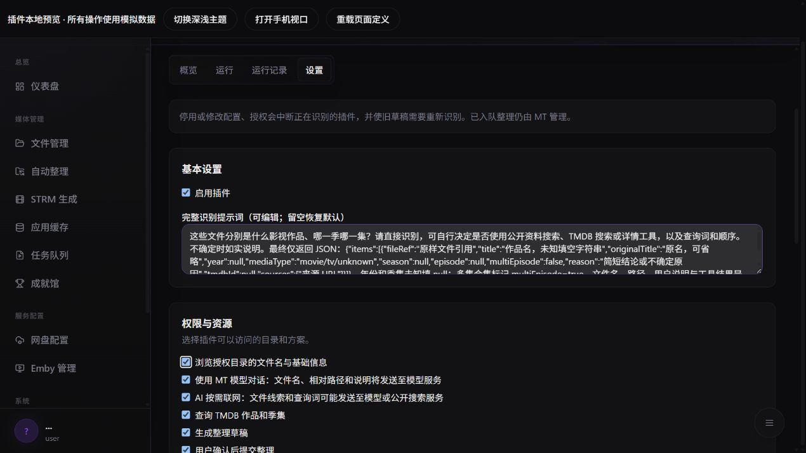
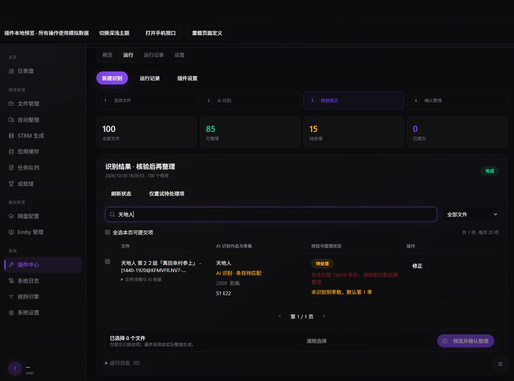

# AI 自主识别整理模板（v1.2.1）

[返回 Wiki](README.md) · [SDK 参考](sdk-reference.md)

## 谁判断作品

AI 自己判断作品、年份和季集。每批最多 8 个文件，最多 100 视频；原始文件名、相对路径和用户说明直接交给模型，不预切词、猜作品，也不调用 MT 内置识别 Agent。没有固定的两阶段识别、搜索词生成、年份放宽或候选过滤策略。

模板通过 ai.capabilities() 检查当前授权与宿主状态，只提供实际可用的 web_search、tmdb_search、tmdb_detail。联网关闭或未授权时，不会向 AI 声明联网工具；状态未知时不额外探测。AI 可直接给出结果，也可以自己决定查询顺序、搜索词、是否换词及何时停止。例如先联网查中文剧名，再查 TMDB；也可直接查 TMDB，或完全不查询。模型调用工具不代表获得新权限，每次 SDK 仍由 MT 检查。

## 输出与保留

最终 JSON 的 items 使用 fileRef 对应文件，不能按数组顺序匹配。每项包含 title、mediaType、year、season、episode、multiEpisode、reason 及可选 tmdbId/sources；完整约定见默认 prompt 和源码。重复或外来引用不能覆盖其他文件。reason 是简短结论，不是内部推理。

AI 知道剧名但未关联 TMDB，仍保留 recognition、类型和季集，显示“已识别，待匹配”。TMDB ID 只是不可信提议，MT 查询真实详情并核验季集之后才可能变为可提交项。来源仅显示实际公开搜索返回且模型引用的链接，按纯文本处理。

未提供季数或返回 null 时默认第 1 季，依据中注明；明确的第 0 季和其他有效季数保留，异常季数不覆盖，缺失集号不猜测。AI 判断为多集合集时请人工处理，不能截取成一集。旧草稿不自动改写。

## 编辑提示词

设置页只有完整 prompt 编辑器，可替换默认任务；留空恢复模板默认值。旧 extractionPrompt / selectionPrompt 只保存在宿主 retiredConfig 中供回退，不再追加或参与运行。一轮说明写在运行页 instructions。作者可以修改业务脚本中的工具描述和分发器，但不能暴露任意 SDK 方法、URL 抓取或整理提交。

下图来自本地模拟预览，展示单个完整提示词编辑器和独立授权说明，不含真实模型配置。

## 限制与失败恢复

每批最多 6 轮模型对话，每运行 chat/complete 合计最多 78 次能力调用，公开搜索最多 32 次，受共享限流、取消和 30 分钟运行时限约束。AI 需遵守这些资源限制，但作品推断策略不由代码限定。

模型明确不支持工具时关闭工具、直接识别，显示“查询工具不可用”；不自动切换模型或开启联网。工具调用失败只给模型脱敏提示，AI 仍可直接回答或选择其他工具。无效 JSON 会保留有限的文本回答供人工查看；不会因格式问题自动执行整理。超时、达到轮数等情况保留已有结论，剩余项待重试。日志不存请求全文、内部推理或搜索服务响应。

## 用户确认

核验通过后仍必须在 MT 确认具体文件、作品、季集和整理方案。模型不能自称“用户已确认”；定时运行只生成草稿。仅重试待处理项生成新运行，不重放已入队任务；中断或 submission_unknown 时先核对任务中心。

## 截图与真实模型验证

下图是模拟输出，只演示未匹配时保留剧名和季集，不证明任何模型的识别准确率。v1.2.1 的来源字段和运行阶段会在对应运行中出现。

真实模型复测需记录宿主和模板版本、模型、联网是否可用、实际查询及识别结论；不能把模拟服务返回的剧名当成准确率验证。FF 边界见[安全规范](../plugins-ai-security.md)。

## 为什么可能有多次 AI 请求

资料足够时 AI 返回最终 JSON，每批一次结束，MT 核验不再请求 AI。每批最多 8 个文件，100 个文件至少 13 批。AI 主动查询时，一轮可提出多个工具调用；全部结果一并交回下一轮，不按每个查询拆成多轮。

公开搜索及 TMDB 成功结果按本次运行缓存，相同参数复用，不改写查询词，不缓存失败。缓存仅驻留宿主内存，包含键和值最多 4 MiB；每次命中仍校验权限、配置与配额，不跨插件或运行共享，最终 MT 核验不使用此缓存。连续两轮重复同一组工具和参数时停止，已有结论保留，剩余项可以重试。

运行页显示版本、批次、文件数、对话轮次、实际查询次数和缓存命中。实际模型请求数含参数兼容重发和原生联网模型调用；Tavily 查询不计作模型请求。Token 只累计服务报告值，缺失显示未知，部分缺失会明确标注。失败请求也计入实际请求，不能把请求少当成准确率提高。

默认提示词增加“资料足够时直接返回，避免重复查询”，但不强制是否查询。升级仅替换未改动的旧默认；完整自定义 prompt 保留，空值运行时使用新默认。旧运行记录没有新增统计时显示“未记录”。
